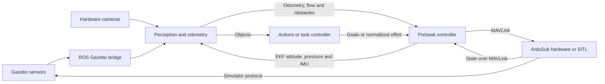

# Mira and Mira simulator topics

The guided system connects Gazebo sensors to ROS vision nodes, then forwards navigation and obstacles through one Pixhawk controller to ArduSub over MAVLink. Hardware cameras replace the Gazebo sensor bridge on the vehicle. The competition and older task controllers are separate launch choices.

Names below use the supplied launch defaults as of 2026-10-16. Configurable names and relative names change with parameters, remappings and namespaces. This is a source inventory, not a live ROS graph: optional plugins, tools and alternate launch modes do not all run together. Installed external nodes can expose additional topics depending on their versions and settings.

[Endpoint source inventory](topic_endpoints.csv) contains 276 records covering publisher/subscriber/service calls, message-filter subscriptions, bridge specifications, topic configuration and Gazebo model declarations in both repositories. [Node source inventory](node_inventory.csv) contains 72 class, constructor and launch records, including alternate launch sites, helpers and examples; these are not counts of unique running nodes. Expressions in these CSVs remain expressions where the name depends on configuration. Vendored Gazebo examples are marked separately.

## Naming schema

Every Mira-owned topic and service is `/mira/<domain>/<subject>[/<name>]` in lower_snake_case. The names are defined once in [`utils/topics.py`](../../src/dependencies/utils/utils/topics.py) and [`utils/topics.hpp`](../../src/dependencies/utils/include/utils/topics.hpp); nodes use those constants rather than string literals.

| Domain | Contents | Producer |
| --- | --- | --- |
| `sensors` | Raw camera and IMU streams | Hardware drivers, or the simulator bridge under the same names |
| `perception` | Per-camera worker outputs, `/mira/perception/<camera>/...` | `mira2_vision` workers |
| `odometry` | Visual odometry, flow velocity and floor heading for the autopilot EKF | Vision odometry and optical flow |
| `state` | Telemetry, EKF pose, attitude, depth, IMU and path | Hardware plugins (MAVLink) |
| `guidance` | GUIDED goals, the active goal and hold | Actions → hardware guided plugin |
| `control` | Normalized effort commands, arm/mode and controller services | Joystick and task controllers → hardware RC plugin |
| `safety` | Emergency stop | Hardware controller |
| `sim` | Ground truth, Gazebo boxes and direct-thruster interfaces; never present on the vehicle | `mira_sim` |
| `replay` | Offline estimators run by diagnostic tools | `mira_sim/misc/tools` |

ROS-standard interfaces (`/clock`, `/tf`, `/tf_static`, `/diagnostics`, `/joy`) and the competition bridge contract topics keep their conventional names. `make check-topics` scans both repositories for names outside the schema and checks the Python and C++ registries agree. Gazebo transport names (`/sim/...`, `/model/...`, `/world/...`) are internal to the simulator and only reach ROS through the bridge.

## Guided data flow

`make guided` starts hardware and vision launches. `make guided-sim` starts their simulation variants. Neither starts Gazebo/SITL. Hardware owns the MAVLink connection; vision publishes ROS estimates and detections.

## Nodes by system

| System | Node or executable | Role and activation |
| --- | --- | --- |
| Hardware | `/mira/pixhawk_controller` | Hosts RC, navigation, guided, telemetry, external-navigation and obstacle plugins; plugin list selects interfaces |
| Hardware | `killswitch` executable | Calls emergency-stop service; supplied launch names it `pymavlink_killswitch` |
| Hardware cameras | `camera_driver_exe` / `camera_driver_ros2_node` | Camera pipeline; front/bottom/auto/IMX335/ZED launches are alternatives |
| Vision | `/mira/perception/front/perception` | Default front perception worker; launch namespace is configurable |
| Vision | `/mira/perception/bottom/perception` | Bottom detection/docking/pipeline worker when launched with that camera/profile |
| Vision | `/mira/perception/bottom_flow/optical_flow` | Started for optical-flow mode or SLAM with optical flow |
| Vision | `/mira/visual_slam/cuvslam_odometry` | Native cuVSLAM when selected |
| Vision | `rtabmap_odom/rgbd_odometry` | Alternative odometry backend, consuming source images directly |
| Actions | `/mira2_actions` | Behavior tree for object navigation, scanning and gate passage |
| Manual control | `/joy_node`, `/joystick_control_node` | Joystick input and normalized effort commands |
| Task control | `gate_navigator`, `phase2_controls`, `bucket_control2`, `pipeline_controls` | Alternate mission controllers; qualification launch renames gate node `gate_balls` |
| Extra perception | `/valve_3d_bbox_node` | Standalone ZED valve detection script |
| Simulator bridge | `/sim_bridge` | Main guided Gazebo-to-ROS bridge |
| Simulator TF | Six `tf_*` static transform publishers | Camera mounts, optical frames, IMU mount and world origin |
| Competition bridge | `competition_bridge`, `sauvc_topics_bridge`, `commands_bridge` | Competition mode; namespace `/bluerov2_bridge` or `/sauvc_bridge` |
| SAUVC demo | `auv_teleop_keyboard`, `entity_spawner` | Velocity command, recording and entity spawning |
| Older SAUVC control | `keyboard_ctrl` | Uses Gazebo entity-state services |
| BlueROV control | `mission_script`, `motion_controller`, `depth_yaw_vision_controller` | Alternate direct thruster control scripts |
| Diagnostic tools | `gate_telemetry`, `ekf_settle`, `grab_bottom`, `probe_cuvslam`, `gate_demo_recorder`, `record_mira_navigation`, `wait_mira_target`, `yaw_drift`, `actions_test` | Opt-in tools under `mira_sim/misc/tools`; interfaces are in the CSV |

`RGBDInputs` is a shared base class inside cuVSLAM, with synchronization and validation. It has no standalone executable or republished input topics.

## Simulator sensor bridge

All entries in the main [bridge configuration](../../../mira_sim/src/dnt_simulator/config/bridge.yaml) flow from Gazebo to ROS. Sensor streams use the same `/mira/sensors/...` names as the hardware drivers, so perception and odometry need no simulator remapping. Image and sensor bridges are lazy; `/clock` is not.

| ROS topic | ROS message type | Gazebo source | Consumers |
| --- | --- | --- | --- |
| `/clock` | `rosgraph_msgs/Clock` | `/clock` | Nodes with `use_sim_time` |
| `/mira/sensors/camera/front/image_raw` | `sensor_msgs/Image` | `/sim/front_camera/image` | Front perception, selected odometry, recording/probe tools |
| `/mira/sensors/camera/front/depth/image_raw` | `sensor_msgs/Image` | `/sim/front_camera/depth_image` | Front perception, selected odometry, recording/probe tools |
| `/mira/sensors/camera/front/camera_info` | `sensor_msgs/CameraInfo` | `/sim/front_camera/camera_info` | Front perception, selected odometry, recording/probe tools |
| `/mira/sim/camera/front/boxes` | `vision_msgs/Detection2DArray` | `/sim/front_camera/boxes` | `gazebo_boxes` detector plugin |
| `/mira/sim/ground_truth/odom` | `nav_msgs/Odometry` | `/model/bluerov2_heavy/odometry` | Hardware navigation in simulation; external navigation in GT mode; diagnostic tools |
| `/mira/sensors/imu` | `sensor_msgs/Imu` | `/world/pool_world/model/bluerov2_heavy/link/base_link/sensor/imu_sensor/imu` | cuVSLAM when IMU fusion is enabled; tools |
| `/mira/sensors/camera/bottom/image_raw` | `sensor_msgs/Image` | `/sim/bottom_camera/image` | Bottom optical-flow worker; tools |
| `/mira/sensors/camera/bottom/camera_info` | `sensor_msgs/CameraInfo` | `/sim/bottom_camera/camera_info` | Bottom optical-flow worker; tools |

## Hardware camera topics

The camera driver publishes `<configured base>/image` and `<configured base>/camera_info`. The supplied hardware launches remap the image suffix to `image_raw`. See [ROS camera publisher](../../src/dependencies/camera_driver/src/publishers/ros2_publisher.cpp) and [camera launches](../../src/mira2_perception/launch).

| Topic | Type | Producer and consumers |
| --- | --- | --- |
| `/mira/sensors/camera/front/image_raw` | `sensor_msgs/Image` | Front camera → front perception and odometry |
| `/mira/sensors/camera/front/camera_info` | `sensor_msgs/CameraInfo` | Front camera → front perception and odometry |
| `/mira/sensors/camera/front/depth/image_raw` | `sensor_msgs/Image` | Default hardware odometry depth input; requires a registered-depth producer configured separately |
| `/mira/sensors/camera/bottom/image_raw` | `sensor_msgs/Image` | Bottom camera → bottom perception or optical flow |
| `/mira/sensors/camera/bottom/camera_info` | `sensor_msgs/CameraInfo` | Bottom camera → bottom perception or optical flow |
| `/camera/image`, `/camera/camera_info` | Image, CameraInfo | Camera-driver test pipeline base `camera` |

Perception can publish the configured raw-image topic itself when its input is a non-ROS source. `image_transport` may add transport-specific endpoints depending on installed plugins. Camera-driver Iceoryx examples also use `Orbbec/Camera/JPEG` and `Lucid/Camera/JPEG`; those are separate non-ROS transports.

## Hardware control and navigation topics

These interfaces belong to [hardware plugins](../../src/mira2_hardware/mira2_hardware/plugins) and the vision estimators that feed them.

| Topic | Type | Publisher → subscriber |
| --- | --- | --- |
| `/mira/control/command` | `custom_msgs/CommandsNormalized` | Joystick or task controller → hardware RC plugin |
| `/mira/state/telemetry` | `custom_msgs/Telemetry` | Hardware telemetry → gate/docking/bucket/pipeline controllers |
| `/mira/guidance/goal` | `geometry_msgs/PoseStamped` | Action nodes or external client → hardware guided plugin |
| `/mira/guidance/goal_direct` | `geometry_msgs/PoseStamped` | Gate action or external client → hardware guided direct-line control |
| `/mira/guidance/active_goal` | `geometry_msgs/PoseStamped` | Hardware guided plugin → goal visualization/tools |
| `/mira/state/pose` | `geometry_msgs/PoseStamped` | Hardware navigation → action nodes and diagnostic tools |
| `/mira/state/attitude` | `geometry_msgs/PoseStamped` | Hardware navigation → optical flow and diagnostic tools |
| `/mira/state/depth` | `geometry_msgs/PointStamped` | Hardware navigation → optical flow |
| `/mira/state/imu` | `sensor_msgs/Imu` | Hardware navigation → optical-flow derotation |
| `/mira/state/path` | `nav_msgs/Path` | Hardware navigation → visualization |
| `/mira/sim/ground_truth/path` | `nav_msgs/Path` | Hardware navigation in simulation → visualization |
| `/mira/odometry/visual` | `nav_msgs/Odometry` | Selected odometry backend → hardware external-navigation plugin in SLAM mode |
| `/mira/odometry/visual/slam_pose` | `geometry_msgs/PoseStamped` | cuVSLAM with native SLAM enabled → optional observers |
| `/mira/odometry/flow_velocity` | `geometry_msgs/TwistWithCovarianceStamped` | Optical-flow plugin → hardware external-navigation plugin |
| `/mira/odometry/floor_heading` | `geometry_msgs/PoseWithCovarianceStamped` | Optical-flow plugin with floor heading enabled → hardware external-navigation plugin in optical-flow mode |
| `/mira/perception/front/obstacles` | `sensor_msgs/LaserScan` | Vision obstacle-distance plugin → hardware obstacle-distance plugin |
| `/joy` | `sensor_msgs/Joy` | `joy_node` → joystick controller |

The external-navigation odometry, ground-truth, flow and heading inputs are configurable. `/mira/sensors/imu` is bridged simulator IMU; `/mira/state/imu` is autopilot IMU forwarded over MAVLink. They have different producers and frame conventions.

## Perception plugin topics

Relative outputs below resolve under the worker namespace. `F` means `/mira/perception/front`, `B` means `/mira/perception/bottom`. The optical-flow worker uses `/mira/perception/bottom_flow`; its velocity and heading outputs have absolute names listed above. See [vision node](../../src/mira2_vision/mira2_vision/node.py), [detectors](../../src/mira2_vision/mira2_vision/detectors) and [consumers](../../src/mira2_vision/mira2_vision/consumers).

| Topic suffix or absolute name | Type | Producer and use |
| --- | --- | --- |
| `F/image`, `B/image` | `sensor_msgs/Image` | Annotated/preview images when image publication is enabled |
| `F/depth`, `B/depth` | `sensor_msgs/Image` | Worker depth output when depth processing publishes it |
| `/diagnostics` | `diagnostic_msgs/DiagnosticArray` | Each perception worker publishes status |
| `F/objects` | `vision_msgs/Detection2DArray` | Objects consumer → actions, gate controller, tools |
| `F/target_point` | `geometry_msgs/Point` | Depth-target consumer |
| `F/target_color` | `std_msgs/String` | Depth-target consumer |
| `F/target_pose` | `geometry_msgs/PoseStamped` | Depth-target consumer |
| `B/markers` | `custom_msgs/ArucoPose` | Markers consumer |
| `B/pipeline/markers` | `std_msgs/String` | Markers consumer |
| `B/dock_pose` | `geometry_msgs/PoseStamped` | Docking-board consumer → docking controller |
| `B/dock_target` | `geometry_msgs/Point` | Docking-board consumer |
| `B/pipeline/offset` | `geometry_msgs/Point` | Pipeline detector → pipeline controller |
| `B/pipeline/angle` | `std_msgs/Float32` | Pipeline detector → pipeline controller |
| `/mira/perception/front/valve` | `custom_msgs/ValveDetection` | Standalone ZED script |
| `/mira/perception/front/valve_pose` | `geometry_msgs/PoseStamped` | Standalone ZED script |

Attaching a plugin to a different worker moves its relative outputs. The supplied bucket controller subscribes to `B/target_pose` and `B/target_color`, while `bucket_front.yaml` produces them under `F` when used with the front worker. Those profiles require a matching namespace/remapping to connect.

The gate task controller also subscribes to `/mira/perception/front/gate_pose` (`geometry_msgs/PoseStamped`). No matching publisher was found in the application source; the current object-driven behavior-tree path consumes `F/objects` instead.

## Competition and alternate simulator topics

These belong to [competition bridge profiles](../../../mira_sim/src/dnt_simulator/config/competition_bridge.yaml), [SAUVC launch](../../../mira_sim/src/sauvc_sim/launch/sauvc25_launch.py), and [BlueROV control scripts](../../../mira_sim/src/bluerov2_control/bluerov2_control).

| Topic | Type | Producer → consumer or bridge |
| --- | --- | --- |
| `/front_camera/left/image_raw` | `sensor_msgs/Image` | Gazebo → competition bridge |
| `/front_camera/right/image_raw` | `sensor_msgs/Image` | Gazebo → competition bridge |
| `/sim/front_camera/points` | `sensor_msgs/PointCloud2` | Gazebo → competition bridge |
| `/bottom_camera` | `sensor_msgs/Image` | Gazebo `/sim/bottom_camera/image` → competition bridge |
| `/side_cam` | `sensor_msgs/Image` | Gazebo → SAUVC bridge/teleop recorder |
| `/realsense/image` | `sensor_msgs/Image` | Gazebo → SAUVC25 bridge/teleop recorder |
| `/realsense/depth_image` | `sensor_msgs/Image` | Gazebo → SAUVC25 bridge |
| `/realsense/points` | `sensor_msgs/PointCloud2` | Gazebo → SAUVC25 bridge |
| `/realsense/camera_info` | `sensor_msgs/CameraInfo` | Gazebo → SAUVC25 bridge |
| `/bottom_cam` | `sensor_msgs/Image` | Gazebo → SAUVC25 bridge/teleop recorder |
| `/cmd_vel` | `geometry_msgs/Twist` | SAUVC keyboard → command bridge → Gazebo velocity controller |
| `/mira/sim/motion_command` | `std_msgs/Float64MultiArray` | Mission script → motion controller |
| `/mira/sim/thrusters` | `std_msgs/Float64MultiArray` | Motion controller or depth/yaw controller → external/alternate thruster integration |
| `/mira/sim/ground_truth/odom` | `nav_msgs/Odometry` | Input expected by depth/yaw controller |
| `/mira/sensors/camera/front/image_raw` | `sensor_msgs/Image` | Input expected by depth/yaw controller |

The BlueROV control scripts now read the guided bridge's ground truth and front camera; nothing in the guided stack consumes `/mira/sim/thrusters`. These scripts are not the guided SITL control path.

## Gazebo transport topics

Gazebo transport is separate from ROS. Bridge tables above identify which sensor topics enter ROS. The [heavy BlueROV model](../../../mira_sim/src/bluerov2_gz/models/bluerov2_heavy/model.sdf) also defines the following paths:

| Gazebo topic or pattern | Role |
| --- | --- |
| `/model/bluerov2_heavy/joint/thruster{1..8}_joint/cmd_thrust` | Eight ArduPilot-plugin command publishers → Gazebo thruster systems |
| `/model/bluerov2_heavy/odometry` | Gazebo ground-truth odometry publisher |
| `/sim/front_camera/image`, `/sim/front_camera/depth_image`, `/sim/front_camera/camera_info`, `/sim/front_camera/points` | RGB-D sensor streams |
| `/sim/front_camera/boxes` | Annotated camera boxes |
| `/front_camera/left/image_raw`, `/front_camera/right/image_raw` | Stereo image sensors |
| `/sim/bottom_camera/image`, `/sim/bottom_camera/camera_info` | Downward camera image and calibration |
| `/world/pool_world/model/bluerov2_heavy/link/base_link/sensor/imu_sensor/imu` | IMU sensor → ArduPilot plugin and ROS bridge |
| `/clock` | Simulation clock |
| `thruster_{0..7}/set_output_force_N` | Alternate demo-AUV model thruster command names |
| `ping_link/sensor/sonar` | Ping-model sonar topic, scoped by Gazebo |

The source CSV also lists vendored aircraft/gimbal/parachute/zoom/GStreamer topics and their dynamic subscription expressions; these are optional models/plugins, not the BlueROV guided system. Gazebo creates additional world, scene, statistics, pose and sensor endpoints at runtime based on loaded worlds and entities.

## Diagnostic and replay topics

Diagnostic tools mostly subscribe to the guided topics already listed. `record_gate_slam.py` additionally creates/uses these configurable estimator and observer paths:

| Topic | Type | Purpose |
| --- | --- | --- |
| `/mira/sim/demo/third_person` | `sensor_msgs/Image` | Spawned observer camera → temporary bridge → recorder |
| `/mira/replay/cuvslam` | `nav_msgs/Odometry` | Replay estimator → recorder |
| `/mira/replay/cuvslam/slam_pose` | `geometry_msgs/PoseStamped` | Replay estimator native SLAM output when enabled |
| `/mira/replay/cuvslam_rgbd` | `nav_msgs/Odometry` | Optional RGB-D-only comparison estimator → recorder |
| `/mira/replay/imu` | `sensor_msgs/Imu` | Estimator subscription name during replay; tool registers recorded IMU directly rather than publishing a ROS stream |

The actions test tool can publish synthetic objects and EKF poses on the normal stack names. Its endpoints are marked as test/example in the source CSV.

## Services and shared ROS topics

Services are listed separately because they are not topics.

| Service | Type | Server and client |
| --- | --- | --- |
| `/mira/control/arm` | `std_srvs/SetBool` | Hardware RC plugin; operator client |
| `/mira/control/change_mode` | `custom_msgs/ChangeMode` | Hardware RC plugin; operator client |
| `/mira/safety/emergency_stop` | `std_srvs/SetBool` | Hardware controller; killswitch client |
| `/mira/guidance/hold` | `std_srvs/Trigger` | Hardware guided plugin; action nodes |
| `/mira/control/pipeline/enable` | `std_srvs/SetBool` | Pipeline controller |
| `/world/pool_world/create` | `ros_gz_interfaces/SpawnEntity` | Gazebo bridge; entity-spawner client |
| `/sauvc_sim/set_entity_state` | `gazebo_msgs/SetEntityState` | Older keyboard controller expects external service |
| `/sauvc_sim/get_entity_state` | `gazebo_msgs/GetEntityState` | Older keyboard controller expects external service |

TF listeners use `/tf` and `/tf_static` (`tf2_msgs/TFMessage`). Hardware navigation broadcasts `odom → base_link`; the markers consumer also broadcasts detected marker transforms. Simulator static publishers define camera/IMU mounts and `odom → world_origin`. `/rosout` and `/parameter_events` are ROS infrastructure topics, subject to node options. Parameter services are generated per node. External RTAB-Map, RViz and image-transport installations can add other interfaces.

For the exact active graph in a running configuration, use `ros2 node list`, `ros2 node info <node>`, `ros2 topic list -t`, and `ros2 topic info -v <topic>`. Use `gz topic -l` separately for Gazebo transport.
